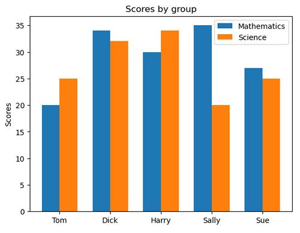

# df.melt() in pandas 

### df.melt() converts your DataFrame from wide format to long format.

### Let's understand with an example.

### Before melt():
```
Algorithm_Name	Accuracy_Score	Precision_Score
SVC	0.99	0.95
KNN	0.97	0.90
```

### Your code:

```
df_melted = df.melt(
    id_vars="Algorithm_Name",
    value_vars=["Accuracy_Score", "Precision_Score"],
    var_name="variable",
    value_name="score"
)
```


### After melt():

```
Algorithm_Name	    variable	            score
SVC	            Accuracy_Score	    0.99
SVC	            Precision_Score	    0.95
KNN	            Accuracy_Score	    0.97
KNN	            Precision_Score	    0.90
```


### What each parameter does
- id_vars: Keeps this column unchanged (Algorithm_Name).
- value_vars: Takes these columns and converts them into rows.
- var_name: Creates a new column named variable.
- value_name: Creates a new column named score.


### Why do we use it?

So that Seaborn can easily plot Accuracy and Precision together using:

```
sns.catplot(
    x="Algorithm_Name",
    y="score",
    hue="variable",
    data=df_melted,
    kind="bar"
)
```


### when we use sns.catplot()

sns.catplot() is used to create categorical plots to compare values across different categories.

### In your example:
```
sns.catplot(
    x="Algorithm_Name",
    y="score",
    hue="variable",
    data=df_melted,
    kind="bar"
)
```


### Here's what each parameter does:

```
x="Algorithm_Name" → Shows algorithm names on the X-axis.


y="score" → Shows their scores on the Y-axis.


hue="variable" → Uses different colours for Accuracy and Precision.


data=df_melted → Takes data from your DataFrame.


kind="bar" → Creates a bar chart.
```

### Simply understand it like this:

#### catplot() creates a graph to compare Accuracy and Precision for each algorithm.

### For example, SVC will have two bars:
- One for Accuracy.
- One for Precision.

```
import pandas as pd
import seaborn as sns

df = pd.DataFrame({
    "Student": ["Ali", "Ali", "Sara", "Sara", "John", "John"],
    "Subject": ["Maths", "Science", "Maths", "Science", "Maths", "Science"],
    "Marks": [90, 85, 95, 80, 75, 88]
})
```


```
Student	       Subject	     Marks
Ali	        Maths	       90
Ali	        Science	       85
Sara	        Maths	       95
Sara	        Science	       80
John	        Maths	       75
John	        Science	       88
```

### Now use catplot()

```
sns.catplot(
    x="Student",
    y="Marks",
    hue="Subject",
    data=df,
    kind="bar"
)
```


```
X-axis: Student names (Ali, Sara, John).


Y-axis: Their marks.


hue: Different colours for Maths and Science.


kind: Displays a bar chart.
```

### Understand the purpose
For Ali:
- Maths = 90
- Science = 85

So, you will see two bars for Ali.

Similarly, Sara and John will also have two bars each.